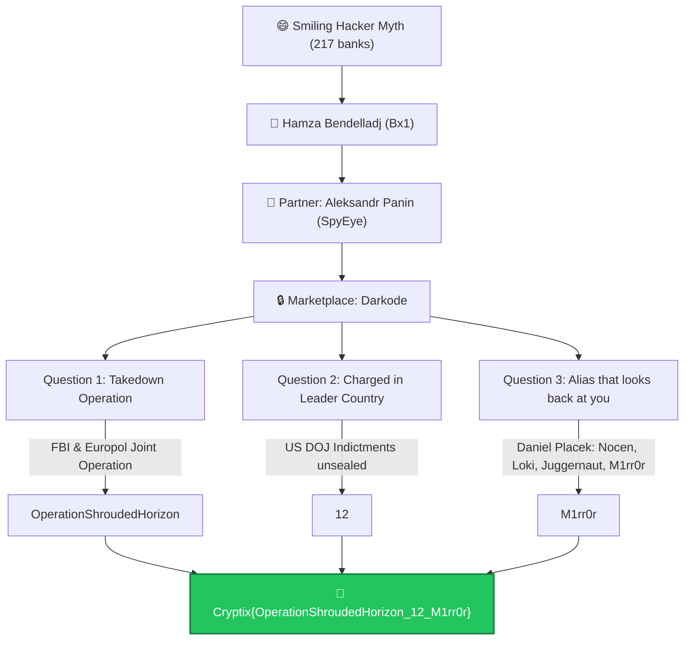

# Behind the Shroud — Cryptix CTF Write-Up

> **Event:** Cryptix CTF — Organized by **HTU Cyber Club** in collaboration with **CYS-TECH**

> [!NOTE]
> Part of the [**Cyrptix CTF OSINT Write-Ups Collection**](https://github.com/Dabuynyx/Cyrptix-CTF-OSINT-write-up).

<div align="center">


</div>

---

## 📋 Challenge Information

| Field | Detail |
| :--- | :--- |
| **Challenge Name** | Behind the Shroud |
| **Category** | OSINT / Cyber Threat Intelligence |
| **Key Subjects** | Hamza Bendelladj (Bx1), Aleksandr Panin (Gribodemon), Daniel Placek (M1rr0r) |
| **Target Infrastructure** | Darkode Cybercrime Marketplace |
| **Final Flag** | `Cryptix{OperationShroudedHorizon_12_M1rr0r}` |

---

## 🎯 Challenge Narrative & Historical Context

The challenge is framed around a viral cybercrime internet legend and the real-world criminal case behind it:

> *"There's a viral story about a smiling hacker who was 'executed' for robbing 217 banks. He wasn't.*  
> *His partner didn't sell his creation on the open internet. He sold it in a private, invite-only marketplace, where only trusted members could enter, and the smiling hacker helped vouch for him there.*  
> *That marketplace was believed to be impenetrable. It wasn't."*

### 1. The Myth vs. The Reality of the "Smiling Hacker"
* **Target Subject:** **Hamza Bendelladj** (online alias **`Bx1`**).
* **The Viral Hoax:** In January 2013, Bendelladj was arrested during a flight layover at Suvarnabhumi Airport in Bangkok, Thailand. A press photo showing him grinning broadly in handcuffs went viral across social media with the false narrative that he was sentenced to death for hacking 217 banks and donating hundreds of millions of dollars to African and Palestinian charities.
* **The Reality:** Bendelladj was extradited to the United States and indicted in the Northern District of Georgia. In April 2016, he was sentenced to **15 years in federal prison** for his role in co-developing and distributing SpyEye.

### 2. The Partner & The Malware Creation
* **Partner:** **Aleksandr Andreevich Panin** (aliases **`Gribodemon`** / **`Harderman`**).
* **Malware:** Panin was the primary creator and vendor of the **SpyEye** banking Trojan—a sophisticated malware platform featuring automated form grabbing, HTML web injections, and credential harvesting that infected millions of PCs worldwide.

### 3. The Private Marketplace
* Panin commercialized SpyEye licenses (selling for $1,000 to $8,500 per custom build) exclusively on **Darkode**.
* **Darkode** was a private, heavily vetted cybercrime forum restricted to elite threat actors trading in botnets, 0-day exploits, and banking Trojans. Bendelladj acted as a prominent member who vouched for new entrants.

---

## 🗺️ Investigation Flowchart



---

## 🔍 Questions & Step-by-Step Investigation

### Question 1: What operation took down Darkode?

> **Prompt:** *Someone got inside and tore it down. What was the name of that operation? (without spaces)*

#### OSINT Investigation:
* Search queries:
  ```text
  Darkode takedown operation
  "Darkode" "FBI" "operation"
  ```
* Findings:
  * In July 2015, an 18-month multinational law enforcement sting led by the FBI’s Pittsburgh Field Office and Europol’s European Cybercrime Centre (EC3) seized Darkode’s domain and backend servers.
  * The official operational codename was **"Operation Shrouded Horizon"**.
  * Removing spaces per flag requirements: `OperationShroudedHorizon`.

**Answer 1:**
```text
OperationShroudedHorizon
```

---

### Question 2: How many were charged in the US?

> **Prompt:** *Dozens were targeted around the world, but how many were charged on the soil of the country that led it?*

#### OSINT Investigation:
* Findings:
  * The operation was spearheaded and led by the United States (Federal Bureau of Investigation and U.S. Attorney's Office for the Western District of Pennsylvania).
  * Globally, approximately 70 members across 20 countries were subject to search warrants, arrests, and interviews.
  * According to the official Department of Justice press release (*"Major Computer Hacking Forum Dismantled"*), federal indictments and criminal complaints were unsealed against exactly **12 individuals** charged under U.S. law.

**Answer 2:**
```text
12
```

---

### Question 3: Who built Darkode and what alias looks back at you?

> **Prompt:** *The man accused of building that marketplace hid behind many names. One of them looks back at you when you look at it. Bring it exactly as he wrote it.*

#### OSINT Investigation:
* Findings:
  * The U.S. federal indictment charged **Daniel Placek** (residing in Glendale, Wisconsin) with conspiracy to commit computer fraud for creating and maintaining Darkode’s infrastructure.
  * The indictment lists Placek's known digital handles:
    * `Nocen`
    * `Loki`
    * `Juggernaut`
    * `M1rr0r`
  * The prompt clue: *"One of them looks back at you when you look at it."* $\implies$ a mirror (`M1rr0r`).
  * Retaining the exact capitalization and leetspeak format: `M1rr0r`.

**Answer 3:**
```text
M1rr0r
```

---

## 🚩 Final Flag

Combining all three components with underscores:
* **Answer 1:** `OperationShroudedHorizon`
* **Answer 2:** `12`
* **Answer 3:** `M1rr0r`

```text
Cryptix{OperationShroudedHorizon_12_M1rr0r}
```

---

## 💡 Summary Attack Chain

```text
Smiling hacker legend
└── Hamza Bendelladj (Bx1)
    └── SpyEye banking Trojan
        └── Aleksandr Panin (Gribodemon)
            └── Darkode Forum
                ├── Operation Shrouded Horizon (Takedown operation)
                ├── 12 charged in the United States
                └── Daniel Placek (Creator alias: M1rr0r)
                    └── Cryptix{OperationShroudedHorizon_12_M1rr0r}
```

---

## 📚 Primary Sources & Intelligence Records

* **U.S. Department of Justice:** [Major Computer Hacking Forum Dismantled (Operation Shrouded Horizon)](https://www.justice.gov/opa/pr/major-computer-hacking-forum-dismantled)
* **Federal Bureau of Investigation:** [Cyber Criminal Forum Taken Down](https://www.fbi.gov/news/stories/cyber-criminal-forum-taken-down)
* **U.S. Attorney's Office (NDGA):** [Two Major International Hackers Who Developed SpyEye Malware Sentenced to Over 24 Years Combined](https://www.justice.gov/usao-ndga/pr/two-major-international-hackers-who-developed-spyeye-malware-get-over-24-years-combined)
* **Krebs on Security:** [The Darkode Cybercrime Forum Up Close](https://krebsonsecurity.com/2015/07/the-darkode-cybercrime-forum-up-close/)
* **Reuters:** [U.S. says computer hacking forum Darkode dismantled, 12 charged](https://www.reuters.com/article/markets/commodities/us-says-computer-hacking-forum-darkode-dismantled-12-charged-idUSL2N0ZV12P/)
* **Ars Technica:** [Criminal hacking bazaar Darkode is dismantled and 70 members are busted](https://arstechnica.com/tech-policy/2015/07/criminal-hacking-bazaar-darkode-is-dismantled-and-70-members-are-busted/)


---

## ⚖️ Legal Policy & Educational Disclaimer

> [!IMPORTANT]
> **Educational & Authorized Research Purpose Only.**  
> All materials, intelligence disclosures, and technical methodologies documented in this repository are for educational, Capture The Flag (CTF) research, and authorized digital forensics training purposes only.
>
> The author strictly condemns and prohibits unauthorized computer access or malicious activities. Any testing or execution of these techniques outside consensual, authorized environments is strictly prohibited.
> 
> For complete terms, non-liability clauses, and international cyber law compliance disclosures, see the official [**Legal Policy & Disclaimer (DISCLAIMER.md)**](DISCLAIMER.md).

---

## 📄 License

This project is licensed under the [MIT License](LICENSE) — see the [LICENSE](LICENSE) file for details.
