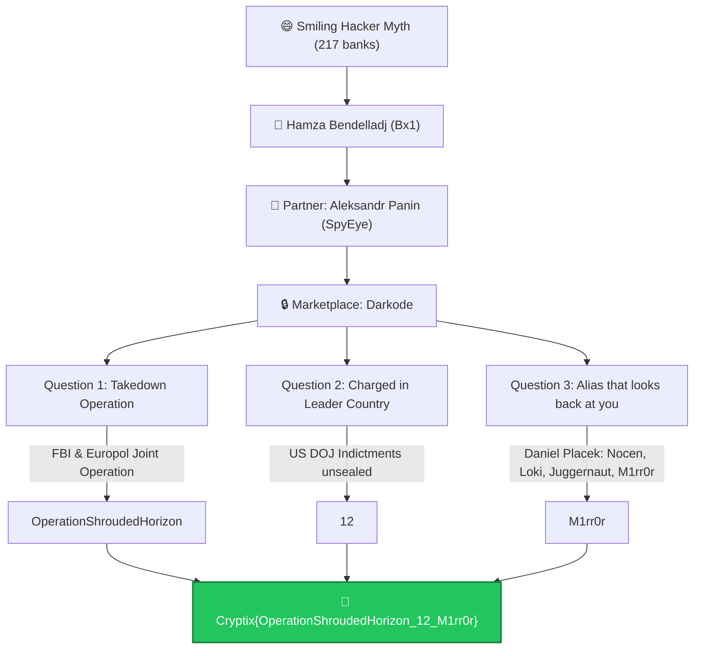

# Behind the Shroud — Cytech CTF Write-Up

<div align="center">


</div>

---

## 📋 Challenge Information

| Field | Detail |
| :--- | :--- |
| **Challenge Name** | Behind the Shroud |
| **Category** | OSINT / Cyber Threat Intelligence |
| **Key Entities** | Hamza Bendelladj (Bx1), Aleksandr Panin (SpyEye), Darkode |
| **Final Flag** | `Cryptix{OperationShroudedHorizon_12_M1rr0r}` |

---

## 🎯 Challenge Narrative & Background

The challenge talks about a **“smiling hacker”** who supposedly got executed for robbing 217 banks:

> *"There's a viral story about a smiling hacker who was 'executed' for robbing 217 banks. He wasn't.*  
> *His partner didn't sell his creation on the open internet. He sold it in a private, invite-only marketplace, where only trusted members could enter, and the smiling hacker helped vouch for him there.*  
> *That marketplace was believed to be impenetrable. It wasn't."*

### 1. Figuring Out the Story
* That points to: **Hamza Bendelladj**
* **Alias:** `Bx1`
* Known for the famous smiling arrest photo in Thailand in 2013.
* The "executed for robbing 217 banks" story was completely fake viral internet lore.
* He was actually extradited to the United States and sentenced to 15 years in prison.
* His partner was: **Aleksandr Andreevich Panin**
* **Aliases:** `Gribodemon`, `Harderman`
* Panin was the creator and core developer of the **SpyEye** banking Trojan.

### 2. Finding the Marketplace
* Panin sold SpyEye through: **Darkode**
* Darkode was a private, invite-only cybercrime forum and trading hub for trusted cybercriminals to buy and sell:
  * Malware & exploit kits
  * Botnets
  * Stolen credentials & credit cards
  * Hacking tools & 0-day exploits
* Bendelladj helped vouch for prospective members and distribute SpyEye there.

---

## 🗺️ Investigation Flowchart



---

## 🔍 Questions & Step-by-Step Findings

### Question 1: What operation took down Darkode?

#### Search & Investigation:
* Search query:
  ```text
  Darkode takedown operation
  ```
* Found the July 2015 international operation led by the FBI and Europol.
* **Operation name:** `Operation Shrouded Horizon`
* Remove spaces per flag specification:
  ```text
  OperationShroudedHorizon
  ```

**Answer 1:**
```text
OperationShroudedHorizon
```

---

### Question 2: How many were charged in the US?

#### Investigation:
* The operation targeted people across around 20 countries.
* Around 70 people were targeted, arrested, or interviewed globally.
* But the question asks specifically how many were charged in the country leading the operation (United States).
* The official U.S. Department of Justice announcement confirmed charges against:
  ```text
  12 individuals
  ```

**Answer 2:**
```text
12
```

---

### Question 3: Who built Darkode and what alias looks back at you?

#### Investigation:
* Identified the forum creator: **Daniel Placek** (charged for creating and operating Darkode).
* Aliases included:
  * `Nocen`
  * `Loki`
  * `Juggernaut`
  * `M1rr0r`
* **The clue:**
  > *“One of them looks back at you when you look at it.”*
* Obviously pointing to a mirror (`M1rr0r`).
* Retaining exact capitalization and leetspeak:
  ```text
  M1rr0r
  ```

**Answer 3:**
```text
M1rr0r
```

---

## 🚩 Final Flag

Assemble all answers:
* Answer 1: `OperationShroudedHorizon`
* Answer 2: `12`
* Answer 3: `M1rr0r`

```text
Cryptix{OperationShroudedHorizon_12_M1rr0r}
```

---

## 💡 Summary Attack Flow

```text
Smiling hacker
└── Hamza Bendelladj (Bx1)
    └── SpyEye
        └── Aleksandr Panin (Gribodemon)
            └── Darkode Forum
                ├── Operation Shrouded Horizon
                ├── 12 charged in the US
                └── Daniel Placek (M1rr0r)
                    └── Cryptix{OperationShroudedHorizon_12_M1rr0r}
```

---

## 📚 Primary Sources & Official Press Releases

* [U.S. Department of Justice — Major Computer Hacking Forum Dismantled](https://www.justice.gov/opa/pr/major-computer-hacking-forum-dismantled)
* [FBI News — Cyber Criminal Forum Taken Down (Operation Shrouded Horizon)](https://www.fbi.gov/news/stories/cyber-criminal-forum-taken-down)
* [DOJ Press Release — Two Major International Hackers Who Developed SpyEye Malware Sentenced](https://www.justice.gov/usao-ndga/pr/two-major-international-hackers-who-developed-spyeye-malware-get-over-24-years-combined)
* [Krebs on Security — The Darkode Cybercrime Forum Up Close](https://krebsonsecurity.com/2015/07/the-darkode-cybercrime-forum-up-close/)
* [Reuters — U.S. says computer hacking forum Darkode dismantled, 12 charged](https://www.reuters.com/article/markets/commodities/us-says-computer-hacking-forum-darkode-dismantled-12-charged-idUSL2N0ZV12P/)
* [Ars Technica — Criminal hacking bazaar Darkode is dismantled and 70 members are busted](https://arstechnica.com/tech-policy/2015/07/criminal-hacking-bazaar-darkode-is-dismantled-and-70-members-are-busted/)
* [Wikipedia — Hamza Bendelladj](https://en.wikipedia.org/wiki/Hamza_Bendelladj)
* [Wikipedia — Dark0de](https://en.wikipedia.org/wiki/Dark0de)
